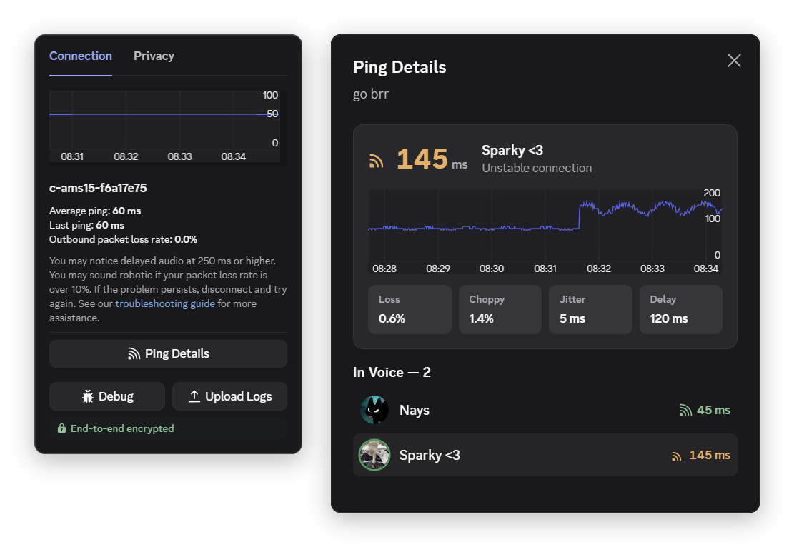

# voicePing

shows everyone's ping in voice

## what it does

- everyone's ping shows up left of their name in your voice channel
- click someone's ping or **Ping Details** in the connection popup, to see their ping details the last 10 minutes
- a heads up when your own connection gets bad

## install

if you made it here you probably already know how to install custom plugins, but if not just check [vencord's guide](https://docs.vencord.dev/installing/custom-plugins/)

## notes

- the ping is each users ping to Discord's voice server *(same number as shown in Discord’s debug menu)*
- works on your current voice channel only
